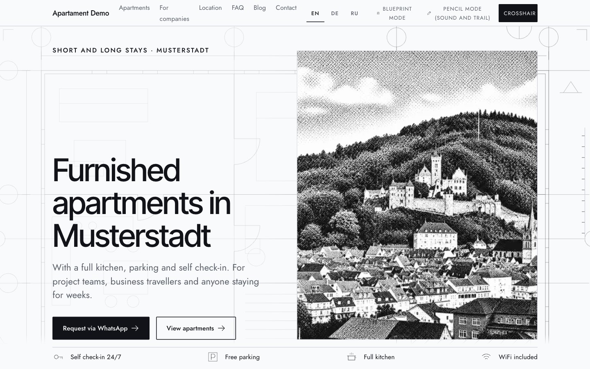

# Apartament Demo



A demo website for furnished apartments in a fictional city (Musterstadt), aimed at contractors and business travellers. The look is an architect's drawing: a blueprint mode, a pencil mode with a trail, and a crosshair cursor.

**Live demo:** https://apartament-demo.vercel.app

## Highlights

- **Blueprint and pencil modes**: an animated blueprint hero, a pencil trail and crosshair cursor, with a way to switch the modes off.
- **Localized routes** in English, German and Russian with `next-intl`.
- **Content that answers questions**: FAQ with search, a blog structure, house rules, a day timeline and an HR planner page for companies.
- **Booking helpers**: date range picker, interactive floor plan, district map and a compare slider.
- **Consent first**: the site sets no tracking cookies, and analytics would only run after consent.
- **SEO**: sitemap, robots and localized metadata.

## Stack

Next.js 16 (App Router), React 19, strict TypeScript, next-intl.

## Run it

```bash
npm install
npm run dev     # http://localhost:3000
npm run build
npm run start
```

## Structure

```
app/[locale]/    pages (home, blog, hr, legal pages) and the 404
components/      HeroBlueprint, InteractivePlan, DateRangePicker, DistrictMap, FaqSearch, CookieConsent ...
messages/        en, de, ru translations
content/         page and blog content
config/ lib/     site settings and helpers
```

## Note

All business data is placeholder content for a demo. Legal pages are demo texts and need review before real use.
